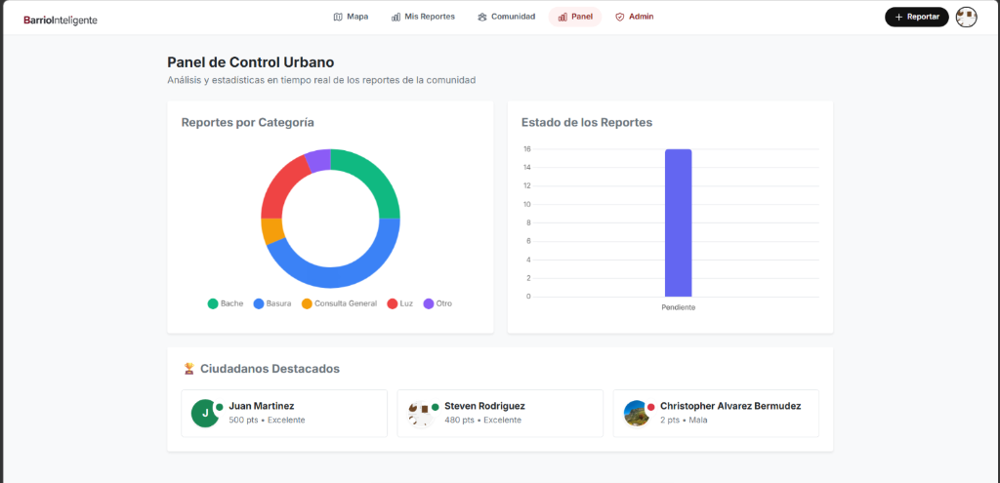
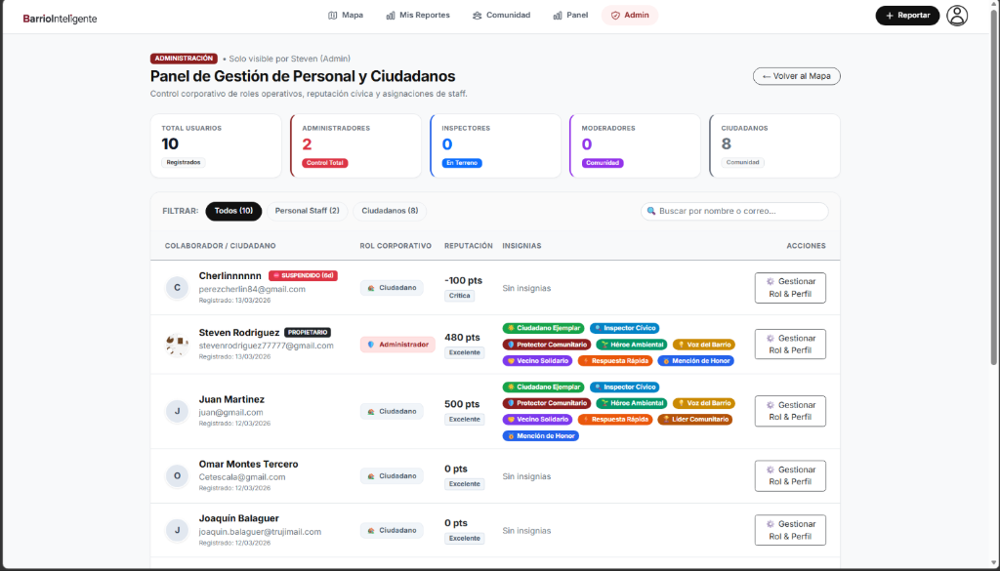
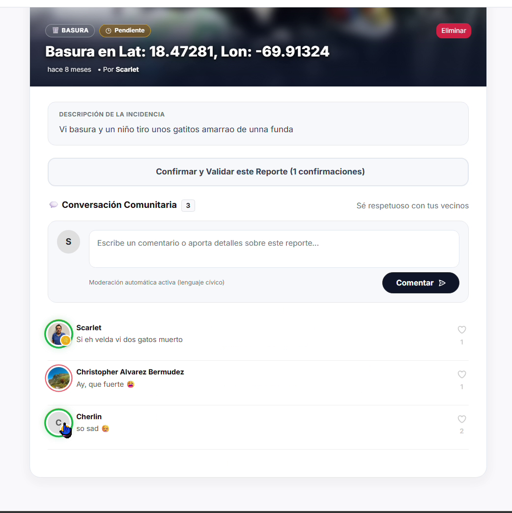
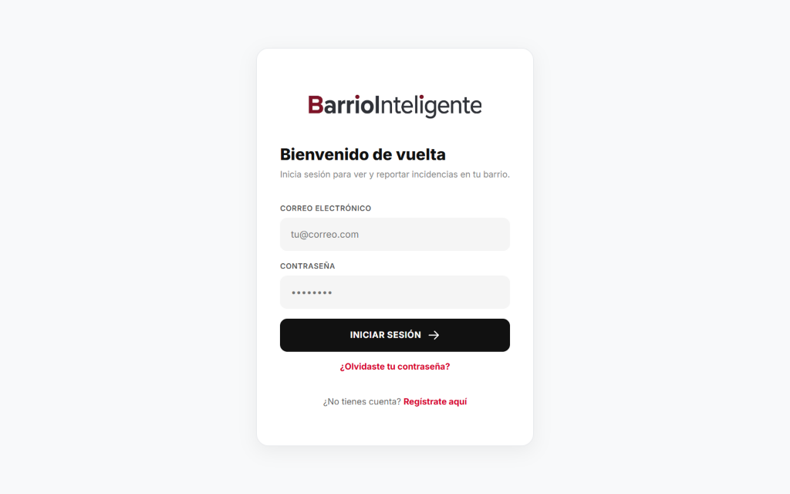
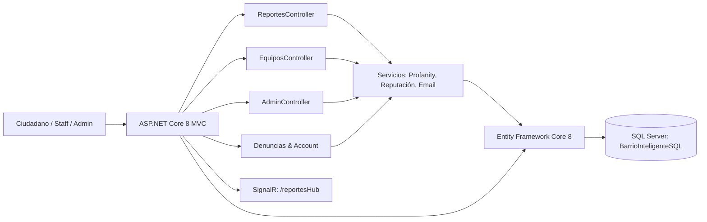

<a id="top"></a>
<div align="center">
  

  <p>
    <strong>Plataforma colaborativa de reportaje urbano, inteligencia territorial y coordinación comunitaria para la República Dominicana.</strong>
  </p>

  <p>
    
    
    
    
    
  </p>

  <p>
    <a href="#descripción-y-objetivo">Descripción</a> ·
    <a href="#funcionalidades-principales">Funcionalidades</a> ·
    <a href="#capturas-del-sistema">Capturas</a> ·
    <a href="#arquitectura-del-sistema">Arquitectura</a> ·
    <a href="#instalación-y-ejecución">Instalación</a> ·
    <a href="#integrantes">Integrantes</a>
  </p>
</div>

---

<details>
  <summary><strong>Tabla de Contenidos</strong></summary>

1. [Descripción y Objetivo](#descripción-y-objetivo)
2. [Funcionalidades Principales](#funcionalidades-principales)
3. [Capturas del Sistema](#capturas-del-sistema)
4. [Arquitectura del Sistema](#arquitectura-del-sistema)
5. [Stack Tecnológico](#stack-tecnológico)
6. [Instalación y Ejecución](#instalación-y-ejecución)
7. [Integrantes](#integrantes)

</details>

---

## Descripción y Objetivo

**Barrio Inteligente** es una plataforma web colaborativa que conecta a los ciudadanos de la República Dominicana con autoridades municipales, equipos operativos y líderes comunitarios para reportar, analizar y resolver incidencias urbanas en tiempo real.

> [!NOTE]
> **Problema:** Falta de atención, trazabilidad y priorización de problemas urbanos cotidianos (baches, acumulación de basura, fallas de luminarias y consultas vecinales) que afectan la calidad de vida en las comunidades.

**Objetivo:** Desarrollar un ecosistema tecnológico centralizado con geolocalización GIS, analítica urbana, reputación cívica y coordinación directa con entidades responsables para transformar los reportes vecinales en soluciones verificables.

---

## Funcionalidades Principales

| Módulo | Capacidades Clave |
| :--- | :--- |
| **Mapa GIS & Mapa de Calor** | Registro georreferenciado validado dentro del territorio terrestre de República Dominicana, marcadores por categoría (`Bache`, `Basura`, `Luz`, `Otro`) y capa de densidad térmica (*heatmap*) filtrable por reportes `Activos` o `Resueltos`. |
| **Comunidad & Tiempo Real** | Feed social de `Reportes` y `Consultas`, ordenamiento por cercanía (fórmula de Haversine) o fecha, validaciones ciudadanas (*upvotes*), comentarios con *likes*, modal rápido de perfil ciudadano y alertas en vivo vía **SignalR** (`/reportesHub`). |
| **Gestión de Estados** | Flujo completo `Pendiente` → `En Proceso` → `Resuelto` para personal Staff/Admin desde Detalles, Comunidad o Dashboard, con auditoría en `HistorialEstados` y recompensa automática de `+10 pts` al resolverse un reporte. |
| **Panel de Control Urbano** | Métricas KPI (`Total`, `Pendientes`, `En Proceso`, `Resueltos`, `% Resolución`), gráficos interactivos con **Chart.js**, distribución de **Salud Cívica**, ciudadanos destacados y gestión rápida en línea. |
| **Apartado `Equipos`** | Centro de coordinación interinstitucional y despacho operativo hacia entidades (**MOPC / Baches**, **Ayuntamiento / Aseo Urbano**, **EDEESTE / EDESUR**, **JCE**, **CAASD**, **Cuadrilla Interna**), con vínculo a reportes, seguimiento y envío opcional por correo. |
| **Reputación & Moderación** | Filtro híbrido de profanidades (`ProfanityService`) en publicaciones y comentarios, escala justa de reputación (`Excelente`, `Buena`, `Regular` desde `0 pts` para cuentas nuevas, `Mala`, `Crítica` en `≤ -50 pts`), insignias progresivas y suspensiones automáticas. |
| **Panel de Administración** | Administración de roles (`Administrador`, `Inspector Urbano`, `Moderador`, `Ciudadano`), ajuste manual de puntos e insignias, levantamiento de sanciones y eliminación lógica (*Soft Delete*). |

---

## Capturas del Sistema

<table>
  <tr>
    <td align="center" width="50%">
      
      <br />
      <sub><strong>Panel de Control Urbano:</strong> estadísticas por categoría, estado y ciudadanos destacados.</sub>
    </td>
    <td align="center" width="50%">
      
      <br />
      <sub><strong>Panel de Administración:</strong> roles corporativos, reputación cívica, insignias y suspensiones.</sub>
    </td>
  </tr>
  <tr>
    <td align="center" width="50%">
      
      <br />
      <sub><strong>Comunidad:</strong> publicaciones georreferenciadas, filtros y validaciones vecinales.</sub>
    </td>
    <td align="center" width="50%">
      
      <br />
      <sub><strong>Detalle de Incidencia:</strong> validaciones, conversación comunitaria y perfiles ciudadanos.</sub>
    </td>
  </tr>
  <tr>
    <td align="center" colspan="2">
      
      <br />
      <sub><strong>Autenticación:</strong> inicio de sesión por cookies, registro con verificación y recuperación por código.</sub>
    </td>
  </tr>
</table>

---

## Arquitectura del Sistema



<details>
  <summary><strong>Estructura del Proyecto</strong></summary>

```text
BarrioInteligente/
├── BarrioInteligente.sln
├── docs/
│   └── screenshots/              # Capturas de la interfaz para documentación
└── BarrioInteligenteWeb/
    ├── Controllers/              # Account, Admin, Denuncias, Equipos, Home, Reportes
    ├── Data/                     # ApplicationDbContext, DemoDataSeeder
    ├── Helpers/                  # InsigniaHelper, TiempoHelper
    ├── Hubs/                     # ReportesHub (SignalR)
    ├── Migrations/               # Migraciones Code First de EF Core
    ├── Models/                   # Usuario, Reporte, Comentario, HistorialEstado, Insignia, EntidadResponsable, ComunicadoEquipo
    ├── Services/                 # ProfanityService, ReputacionService, EmailService
    ├── Views/                    # Vistas Razor (Reportes, Equipos, Admin, Account, Shared)
    ├── wwwroot/                  # CSS (barrio.css), JS, Bootstrap, imágenes y uploads
    ├── appsettings.json
    └── Program.cs
```

</details>

---

## Stack Tecnológico

| Capa | Tecnología | Uso en el Proyecto |
| :--- | :--- | :--- |
| **Backend** | **C# / .NET 8 (ASP.NET Core MVC)** | Controladores, vistas Razor, autorización por roles y autenticación por cookies. |
| **Persistencia** | **SQL Server + Entity Framework Core 8** | Enfoque *Code First* con migraciones automáticas y filtros globales de *Soft Delete*. |
| **Tiempo Real** | **ASP.NET Core SignalR** | Notificación instantánea de nuevos reportes en el mapa (`/reportesHub`). |
| **Mapas & UI** | **Leaflet 1.9.4 + Chart.js + Bootstrap 5** | Mapa colaborativo GIS, *heatmap* de incidencias y gráficos analíticos. |
| **Observabilidad** | **Serilog (`Serilog.AspNetCore`)** | Registro estructurado en consola y archivos rotativos en `Logs/`. |

---

## Instalación y Ejecución

### Prerrequisitos
- [.NET 8 SDK](https://dotnet.microsoft.com/download/dotnet/8.0)
- **SQL Server** (instancia local por defecto `.` o configurar `ConnectionStrings:DefaultConnection` en `BarrioInteligenteWeb/appsettings.json`)

> [!IMPORTANT]
> Al iniciar la aplicación, `Program.cs` ejecuta automáticamente `context.Database.Migrate()`, carga los datos iniciales de demostración si la tabla `Usuarios` está vacía, sincroniza los niveles de reputación y precarga las entidades operativas (`MOPC`, `Ayuntamiento`, `EDEESTE/EDESUR`, `JCE`, `CAASD` y `STAFF`).

### Pasos para ejecutar localmente

1. **Clonar el repositorio:**
   ```bash
   git clone https://github.com/StevenRodriguez44/BarrioInteligente.git
   cd BarrioInteligente/BarrioInteligenteWeb
   ```

2. **Configurar la cadena de conexión y correo SMTP (opcional):**
   Ajusta `ConnectionStrings:DefaultConnection` en `appsettings.json` si tu instancia de SQL Server no es local (`.`). Para habilitar el envío real de correos, configura User Secrets:
   ```bash
   dotnet user-secrets set "SmtpSettings:SenderEmail" "tu-correo@gmail.com"
   dotnet user-secrets set "SmtpSettings:Password" "tu-app-password"
   ```

3. **Ejecutar la aplicación:**
   ```bash
   dotnet run
   ```
   Abre tu navegador en **`http://localhost:5005`**.

<details>
  <summary><strong>Referencia histórica: Script SQL inicial (MySQL)</strong></summary>

En la primera versión prototipo del proyecto se utilizaba la siguiente estructura base en MySQL antes de migrar a **Entity Framework Core Code First + SQL Server**:

```sql
CREATE DATABASE BarrioInteligenteDb;
USE BarrioInteligenteDb;

CREATE TABLE Reportes (
    Id INT AUTO_INCREMENT PRIMARY KEY,
    Titulo VARCHAR(100) NOT NULL,
    Descripcion TEXT,
    Categoria VARCHAR(50) NOT NULL,
    Ubicacion VARCHAR(200) NOT NULL,
    Fecha DATETIME DEFAULT CURRENT_TIMESTAMP
);
```

</details>

---

## Integrantes

| Integrante | Matrícula |
| :--- | :--- |
| **Steven Guiseppe Rodríguez** | `A00116539` |
| **Brian Almonte Sosa** | `A00116791` |
| **Kiara Evianny Medina Corporan** | `A00116054` |
| **Christopher Alvarez Bermudez** | `A00116310` |
| **Elian Emmanuel De Jesús Guzmán** | `A00115958` |

<p align="right">(<a href="#top">volver arriba</a>)</p>
